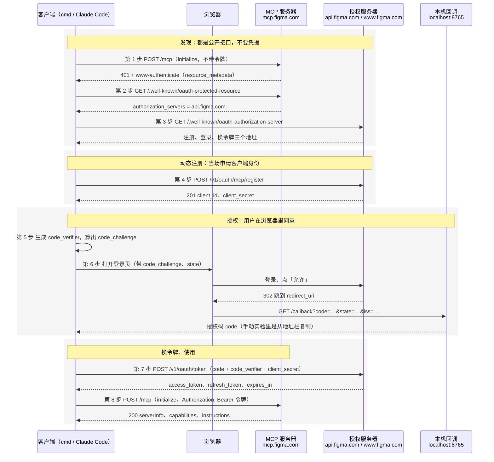
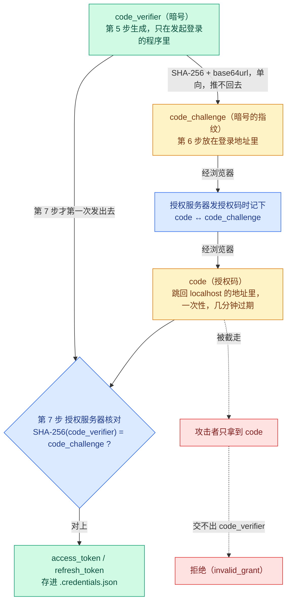

# MCP 服务器的 OAuth 登录：动态注册流程

设置页「连接器」里点「登录」时，Claude Code 在背后走的是 MCP 规范里的 OAuth 授权流程：发现授权服务器、**动态注册客户端**、PKCE、浏览器授权、换令牌（网关这边怎么接的见 [README.md](README.md)「MCP 服务器的 OAuth 登录」）。这份文档用 curl 把这个流程手动走一遍，每一步看实际的请求和响应。

- 实测：2026-11-26，Windows 的 cmd（命令提示符），服务器是 Figma（`https://mcp.figma.com/mcp`）。
- 对照的 Claude Code 是 SDK 0.3.331 自带的 2.1.331。
- 文中的 `client_id`、`client_secret`、授权码、令牌都换成了占位符，真实值不要写进文档。

## 1. 总览



各方的角色：

| 角色 | 本例 | 做什么 |
| --- | --- | --- |
| 客户端 | cmd 里的 curl；平时是 Claude Code | 发起登录、保管 `code_verifier` 和令牌 |
| MCP 服务器（资源服务器） | `mcp.figma.com` | 只检查令牌，不发令牌；告诉客户端去哪里要令牌 |
| 授权服务器 | `api.figma.com`（接口）、`www.figma.com`（登录页） | 注册客户端、让用户登录和同意、发令牌 |
| 浏览器 | 用户自己的浏览器 | 用户在这里登录、点「允许」；授权码经它跳回本机 |
| 回调地址 | `http://localhost:8765/callback` | 收授权码。Claude Code 会在随机端口上真的监听；手动实验时没人监听，页面打不开，从地址栏复制网址 |

## 2. cmd 的写法

- cmd **不认单引号**。`-d '{"a":1}'` 会把 JSON 拆坏，Figma 回 400。要整段用双引号包起来，里面的双引号写成 `\"`。
- 变量用 `set NAME=值` 存，用 `%NAME%` 引用。
- 在 cmd 里执行 `powershell -Command "…"` 时，cmd 不动 `$`，脚本原样交给 PowerShell；同一条命令放到 PowerShell 窗口里执行，外层双引号里的 `$变量` 会先被展开成空，脚本就坏了。
- PowerShell 5.1 里 `curl` 是 `Invoke-WebRequest` 的别名，要真正的 curl 得写 `curl.exe`。下面的命令都在 cmd 里执行。

## 3. 第 1 步：不带令牌连 MCP 服务器

MCP 连接的第一个请求是 `initialize`：

```bat
curl -i -X POST https://mcp.figma.com/mcp -H "Content-Type: application/json" -H "Accept: application/json, text/event-stream" -d "{\"jsonrpc\":\"2.0\",\"id\":1,\"method\":\"initialize\",\"params\":{\"protocolVersion\":\"2025-06-18\",\"capabilities\":{},\"clientInfo\":{\"name\":\"curl-test\",\"version\":\"1.0\"}}}"
```

结果：

```
HTTP/1.1 401 Unauthorized
www-authenticate: Bearer resource_metadata="https://mcp.figma.com/.well-known/oauth-protected-resource",scope="mcp:connect",authorization_uri="https://api.figma.com/.well-known/oauth-authorization-server"
```

- `401`：没有令牌，不让连。客户端看到 401 才知道这个服务器要登录，才往下走。
- `Bearer`：以后请求要带 `Authorization: Bearer <令牌>`。
- `resource_metadata`：这个服务器的授权配置在哪里，是 MCP 规范要求的字段（RFC 9728），下一步读它。
- `scope`：登录时申请的权限范围，第 6 步用。
- `authorization_uri`：Figma 额外给的授权服务器地址，不是标准字段。标准做法从 `resource_metadata` 里找，这里不走捷径。

**Claude Code 显示「需要认证」看的就是这一步。** 网关的设置页取的是 SDK 的 `mcpServerStatus()`（`gateway/src/agent/capabilities.ts`），Claude Code 连接时 `initialize` 收到 401，状态就是 `needs-auth`；能连上、列出工具就是 `connected`。Gmail 为什么不一样，见第 12 节。

## 4. 第 2 步：读受保护资源的配置

```bat
curl -s https://mcp.figma.com/.well-known/oauth-protected-resource
```

```json
{
  "resource": "https://mcp.figma.com/mcp",
  "authorization_servers": ["https://api.figma.com"],
  "bearer_methods_supported": ["header"],
  "scopes_supported": ["mcp:connect"],
  "resource_name": "Figma MCP",
  "resource_documentation": "https://developers.figma.com/docs/figma-mcp-server/"
}
```

这份是「受保护资源元数据」（RFC 9728），说明 MCP 服务器自己：

- `resource`：资源标识。第 6、7 步作为 `resource` 参数带上，表示令牌是给这个服务器用的。
- `authorization_servers`：**谁负责发令牌**。MCP 服务器只检查令牌，发令牌的是另一个服务（这里碰巧都属于 Figma）。
- `bearer_methods_supported: ["header"]`：令牌只能放在请求头里。

## 5. 第 3 步：读授权服务器的配置

按 RFC 8414，授权服务器的配置固定在 `<授权服务器>/.well-known/oauth-authorization-server`：

```bat
curl -s https://api.figma.com/.well-known/oauth-authorization-server
```

| 字段 | 值 | 用途 |
| --- | --- | --- |
| `issuer` | `https://api.figma.com` | 授权服务器的身份，要和第 2 步的地址一致 |
| **`registration_endpoint`** | `https://api.figma.com/v1/oauth/mcp/register` | **动态注册**的地址，第 4 步 |
| `authorization_endpoint` | `https://www.figma.com/oauth/mcp` | 登录页，第 6 步 |
| `token_endpoint` | `https://api.figma.com/v1/oauth/token` | 换令牌、刷新令牌，第 7 步 |
| `code_challenge_methods_supported` | `["S256"]` | 支持 PKCE，用 SHA-256 |
| `token_endpoint_auth_methods_supported` | `["client_secret_basic","client_secret_post"]` | 换令牌时 `client_secret` 放请求头或请求体。**没有 `none`**，第 7 步就卡在这里 |
| `grant_types_supported` | `authorization_code`、`refresh_token` 等 | 授权码换令牌，刷新令牌续期 |
| `require_state_parameter` | `true` | 登录地址必须带 `state` |
| `authorization_response_iss_parameter_supported` | `true` | 回调地址里带 `iss`（RFC 9207） |

没有 `registration_endpoint` 就不能动态注册。Google（`accounts.google.com`）的这份配置里就没有，见第 12 节。

## 6. 第 4 步：动态注册

**动态注册**（Dynamic Client Registration，RFC 7591）：客户端自己调用授权服务器的接口，当场申请一个 OAuth 客户端身份（`client_id`），不用开发者提前去服务商的控制台登记。MCP 客户端事先不知道用户会接哪些服务器，没法挨家登记，所以 MCP 规范推荐服务器支持它。

第一次用自己起的名字注册，被拒：

```bat
curl -s -X POST https://api.figma.com/v1/oauth/mcp/register -H "Content-Type: application/json" -d "{\"client_name\":\"curl-test\",\"redirect_uris\":[\"http://localhost:8765/callback\"],\"grant_types\":[\"authorization_code\",\"refresh_token\"],\"response_types\":[\"code\"],\"token_endpoint_auth_method\":\"client_secret_post\"}"
```

```
Forbidden
```

Figma 的远程 MCP 服务器只对它认可的客户端开放（Claude Code、VS Code、Cursor 等），注册接口会检查请求内容。改成和 Claude Code 一样的格式就成功了：

```bat
curl -i -X POST https://api.figma.com/v1/oauth/mcp/register -H "Content-Type: application/json" -d "{\"client_name\":\"Claude Code (figma)\",\"redirect_uris\":[\"http://localhost:8765/callback\"],\"grant_types\":[\"authorization_code\",\"refresh_token\"],\"response_types\":[\"code\"],\"token_endpoint_auth_method\":\"none\",\"scope\":\"mcp:connect\"}"
```

```
HTTP/1.1 201 Created

{"client_id":"<CLIENT_ID>","client_secret":"<CLIENT_SECRET>","client_id_issued_at":1795713289,"client_secret_expires_at":0,"client_name":"Claude Code (figma)","redirect_uris":["http://localhost:8765/callback"],"token_endpoint_auth_method":"none","scope":"mcp:connect openid email"}
```

- `client_id`：之后每一步都要带。
- `client_secret`：请求里说了 `none`（不要密钥），Figma 还是发了，而且第 7 步要用。`client_secret_expires_at: 0` 是永不过期。
- `scope`：Figma 自己加了 `openid email`。

两次请求有三处不同（`client_name`、`token_endpoint_auth_method`、多了 `scope`），只能确认 Figma 对注册请求有限制，具体查哪一项没有分开测。

Claude Code 注册时发的内容（从 2.1.331 的程序里找到的 `clientMetadata`）：

```js
{
  client_name: `Claude Code (${serverName})`,
  redirect_uris: [redirectUri],            // http://localhost:<随机端口>/callback
  grant_types: ["authorization_code", "refresh_token"],
  response_types: ["code"],
  token_endpoint_auth_method: "none",
  scope: "<资源元数据里的 scope>"           // 有的话才带
}
```

这里用 `Claude Code (figma)` 只是为了做实验。动态注册本身不验证客户端是谁，谁都能报这个名字（见第 11 节「冒名」）。

## 7. 第 5 步：生成 PKCE 的一对随机串

1. 随机生成 `code_verifier`，自己留着。
2. 对它算 SHA-256，再做 base64url 编码，得到 `code_challenge`。base64url 就是普通 base64 去掉末尾的 `=`，把 `+` 换成 `-`、`/` 换成 `_`。
3. 第 6 步只发 `code_challenge`，第 7 步才发 `code_verifier`。

cmd 算不了 SHA-256，在 cmd 里调用 PowerShell 来算：

```bat
powershell -NoProfile -Command "$b=New-Object byte[] 32; [Security.Cryptography.RandomNumberGenerator]::Create().GetBytes($b); $v=[Convert]::ToBase64String($b).TrimEnd('=').Replace('+','-').Replace('/','_'); $h=[Security.Cryptography.SHA256]::Create().ComputeHash([Text.Encoding]::ASCII.GetBytes($v)); $c=[Convert]::ToBase64String($h).TrimEnd('=').Replace('+','-').Replace('/','_'); 'code_verifier=' + $v; 'code_challenge=' + $c"
```

```
code_verifier=<CODE_VERIFIER>
code_challenge=<CODE_CHALLENGE>
```

32 个随机字节编码后是 43 个字符，正好是规范允许的最短长度（43 到 128）。可以拿 openssl 核对 `code_challenge`：`printf %s "<CODE_VERIFIER>" | openssl dgst -sha256 -binary | base64 | tr '+/' '-_' | tr -d '='`。

## 8. 第 6 步：浏览器授权，拿授权码

把下面的地址复制到**浏览器地址栏**里打开（不是在 cmd 里执行）：

```
https://www.figma.com/oauth/mcp?response_type=code&client_id=<CLIENT_ID>&redirect_uri=http%3A%2F%2Flocalhost%3A8765%2Fcallback&scope=mcp%3Aconnect&state=<STATE>&code_challenge=<CODE_CHALLENGE>&code_challenge_method=S256&resource=https%3A%2F%2Fmcp.figma.com%2Fmcp
```

| 参数 | 意思 |
| --- | --- |
| `response_type=code` | 授权码方式：先给授权码，不直接给令牌 |
| `client_id` | 第 4 步拿到的，表示是谁来要权限 |
| `redirect_uri` | 跳回哪里，必须和注册时填的完全一致 |
| `scope` | 申请的权限 |
| `state` | 随机串，跳回来时原样带回，用来核对回调是不是这次登录的 |
| `code_challenge` / `code_challenge_method` | PKCE |
| `resource` | 令牌给哪个 MCP 服务器用 |

授权页上显示的是「Claude Code (figma)」。点「允许」后，浏览器跳到：

```
http://localhost:8765/callback?code=<CODE>&iss=https%3A%2F%2Fapi.figma.com&state=<STATE>
```

本机 8765 端口没有程序在监听，页面打不开，这是正常的，从地址栏复制网址就行。

- `code`：授权码，只能用一次，几分钟就过期。
- `state`：和发出去的一致，说明回调是这次登录的。
- `iss`：签发方，客户端核对它等于第 3 步的 `issuer`，防止同时接了几家授权服务器时把 A 家的授权码交给 B 家（RFC 9207）。

## 9. 第 7 步：用授权码换令牌

拿到授权码后**马上执行**：

```bat
curl -s -X POST https://api.figma.com/v1/oauth/token --data-urlencode "grant_type=authorization_code" --data-urlencode "code=<CODE>" --data-urlencode "redirect_uri=http://localhost:8765/callback" --data-urlencode "client_id=<CLIENT_ID>" --data-urlencode "client_secret=<CLIENT_SECRET>" --data-urlencode "code_verifier=<CODE_VERIFIER>" --data-urlencode "resource=https://mcp.figma.com/mcp"
```

```json
{
  "user_id": "<USER_ID>",
  "access_token": "figu_<…>",
  "token_type": "bearer",
  "refresh_token": "figur_<…>",
  "expires_in": 7776000,
  "scope": "mcp:connect"
}
```

- `access_token`：之后放进 `Authorization: Bearer <令牌>`。`bearer` 是持有者令牌，谁拿着谁就能用。
- `expires_in`：7776000 秒，也就是 90 天。
- `refresh_token`：过期后拿它到同一个 `token_endpoint` 换新令牌（`grant_type=refresh_token`），不用再在浏览器里登录。Claude Code 的「过期自动刷新」就是这个。
- `scope`：只给了第 6 步申请的 `mcp:connect`，第 4 步 Figma 加的 `openid email` 没有出现。

Claude Code 存在 `.credentials.json` 的 `mcpOAuth` 里的就是这些，再加上第 4 步的客户端信息：`clientId`、`clientSecret`、`redirectUri`、`accessToken`、`refreshToken`、`expiresAt`、`scope`、`issuer`、`discoveryState`。

**第一次失败了**：没带 `client_secret` 时返回

```json
{"error":"invalid_grant","error_description":"An error occurred processing your request"}
```

重做第 6 步拿到新授权码，加上 `client_secret` 就成功了。同时改了两样，失败原因分不清：可能是授权码过期了，也可能是 Figma 必须带密钥（第 3 步的配置里没有 `none`，Claude Code 存的登录信息里也有 `clientSecret`，后者可能性更大）。按标准，缺少客户端认证应该报 `invalid_client`，Figma 统一报成了 `invalid_grant`。

## 10. 第 8 步：带上令牌，连 MCP 服务器

```bat
set TOKEN=<ACCESS_TOKEN>
```

**8a：带令牌重发 `initialize`**

```bat
curl -i -X POST https://mcp.figma.com/mcp -H "Authorization: Bearer %TOKEN%" -H "Content-Type: application/json" -H "Accept: application/json, text/event-stream" -d "{\"jsonrpc\":\"2.0\",\"id\":1,\"method\":\"initialize\",\"params\":{\"protocolVersion\":\"2025-06-18\",\"capabilities\":{},\"clientInfo\":{\"name\":\"curl-test\",\"version\":\"1.0\"}}}"
```

和第 1 步只差 `Authorization` 一行，这次正常返回。响应是 SSE 格式（每条消息以 `data: ` 开头），因为 `Accept` 里两种都写了，由服务器选：

| 字段 | 内容 |
| --- | --- |
| `protocolVersion` | `2025-06-18` |
| `capabilities` | `tools`、`prompts`、`resources`，都带 `listChanged: true`（列表变了会主动通知） |
| `serverInfo` | `Figma MCP Server` 1.0.0，带 base64 的 PNG 图标 |
| `instructions` | 给模型看的使用说明，Claude Code 放进模型的系统提示里 |

**8b、8c：初始化完成通知、列出工具（命令给出了，还没实测）**

按 MCP 协议，`initialize` 之后客户端先发 `notifications/initialized`，再正常调用。响应头里有 `mcp-session-id` 的话，之后每个请求都要带上（`set SID=<会话编号>`）；没有就是无状态服务器，删掉 `-H "Mcp-Session-Id: %SID%"`。

```bat
curl -i -X POST https://mcp.figma.com/mcp -H "Authorization: Bearer %TOKEN%" -H "Mcp-Session-Id: %SID%" -H "MCP-Protocol-Version: 2025-06-18" -H "Content-Type: application/json" -H "Accept: application/json, text/event-stream" -d "{\"jsonrpc\":\"2.0\",\"method\":\"notifications/initialized\"}"
```

预期 `202 Accepted`，没有响应体。

```bat
curl -s -X POST https://mcp.figma.com/mcp -H "Authorization: Bearer %TOKEN%" -H "Mcp-Session-Id: %SID%" -H "MCP-Protocol-Version: 2025-06-18" -H "Content-Type: application/json" -H "Accept: application/json, text/event-stream" -d "{\"jsonrpc\":\"2.0\",\"id\":2,\"method\":\"tools/list\"}" | powershell -NoProfile -Command "$t=[Console]::In.ReadToEnd(); $d=@($t -split [char]10 | Where-Object { $_.StartsWith('data:') }); if ($d.Count) { $t=$d[0].Substring(5) }; $j=$t | ConvertFrom-Json; 'tools: ' + $j.result.tools.Count; $j.result.tools | ForEach-Object { $_.name }"
```

末尾交给 PowerShell 去掉 `data: `，只打印工具数和工具名。到这一步就和设置页显示「已连接 N 个工具」一样了。

## 11. 边界：每样东西管什么、不管什么



图例：绿色只在本机、要保密；黄色经过浏览器，默认可能被别人看到；蓝色在授权服务器上；红色是攻击路径。

用存衣服打个比方：授权码是取衣票，`code_verifier` 是存衣服前想好的暗号，`code_challenge` 是暗号的指纹。存的时候只给前台指纹，取的时候交票、说暗号，前台算一遍指纹对得上才给。小偷偷了票说不出暗号，看到过指纹也推不回暗号。

| 机制 | 保护什么 | 不管什么 |
| --- | --- | --- |
| **PKCE** | 授权码在跳回本机的路上被拿到（别的程序抢占回调端口、浏览器历史和扩展、日志、贴给了别人），也换不成令牌 | 见下表 |
| **`state`** | 跳回来的回调必须是自己发起的那次登录，防止别人把他的回调塞给你 | 授权码被截走 |
| **`iss`** | 授权码交回给签发它的那家授权服务器 | 其余 |
| **`client_secret`** | 证明「我是这个客户端」，只对能保密的服务器端应用有意义 | 桌面程序、命令行里的密钥一拆就能看到，所以 Claude Code 这类公开客户端注册时用 `none`，靠 PKCE。Figma 照样发了密钥、换令牌也要，但它出现在本机文件、聊天记录里，算不上秘密 |
| **HTTPS** | 网络窃听 | 本机上的程序 |

PKCE 只保证「换令牌的就是发起登录的那个程序」，以下情况它不管：

| 情况 | PKCE 管不管 | 靠什么 |
| --- | --- | --- |
| 能读发起登录的程序的内存或文件 | 不管，`code_verifier` 也在那里 | 操作系统隔离 |
| 令牌换到手后被偷（`.credentials.json` 被读走） | 不管，PKCE 到第 7 步就结束了 | 文件权限、macOS 钥匙串 |
| **冒名**：谁都能动态注册一个叫「Claude Code (figma)」的客户端（第 4 步就是） | 不管，PKCE 不证明客户端是谁 | 服务商的白名单、审核；用户看授权页时判断 |
| 用户在授权页上同意了恶意应用 | 不管 | 用户判断 |
| 把别人的授权码塞进你的登录流程 | 部分管：塞进来的 `code` 对应别人的 `code_challenge`，你的 `code_verifier` 对不上 | 主要靠 `state` |
| 第 6 步的登录地址在浏览器里被篡改（换成攻击者的 `code_challenge`） | 不管，PKCE 默认这个请求没被改过 | HTTPS、浏览器本身没被攻破 |

另外：

- 必须用 `S256`。PKCE 还有 `plain` 方式，`code_challenge` 就等于 `code_verifier`，第 6 步就暴露了，起不到作用。Figma 只支持 `S256`。
- 要保密的只有 `code_verifier`，而且只保密几分钟，换完令牌就作废；`code_challenge`、`code`、`state` 经过浏览器，默认可能被看到。
- 第 7 步实测时，Figma 对 `code_verifier` 错误的请求是否会把授权码作废，没有单独测。很多服务器会这么做，遇到时重做第 6 步。

## 12. 对照：Gmail 为什么显示「已连接」

`https://gmailmcp.googleapis.com/mcp/v1` 不带凭据实测：

| 请求 | 结果 |
| --- | --- |
| `initialize` | 200 |
| `tools/list` | 200，23 个工具 |
| `tools/call`（如 `list_labels`） | **401**，`www-authenticate: Bearer resource_metadata=".../.well-known/oauth-protected-resource/list_labels"`，按工具分开 |

Claude Code 判断状态只做到连接、列工具，两步都成功就是 `connected`，设置页不出「登录」，模型调用工具时才报缺少认证；「断开」（清令牌）后照样是已连接，提示「没有保存的登录信息」。

即使走到登录这一步也不行：`resource_metadata` 指向的授权服务器是 `accounts.google.com`，它的 `/.well-known/openid-configuration` 和 `/.well-known/oauth-authorization-server` 都**没有 `registration_endpoint`**，也没有 `client_id_metadata_document_supported`（MCP 新规范里另一种不用提前登记的方式）。只能在 Google Cloud Console 手动建 OAuth 客户端，把 `client_id`、`client_secret` 交给 Claude Code。连接器市场对这类服务器的处理见 [README.md](README.md)（`custom_oauth_client_id`、`--client-id`）。

## 13. 做完实验

- 第 4 步注册的客户端留在 Figma 那边，没有绑定账号，不影响什么。
- 第 7 步拿到的令牌能访问自己的 Figma 账号，`refresh_token` 还能一直续。做完到 Figma 的账号设置里撤销「Claude Code (figma)」的授权。
